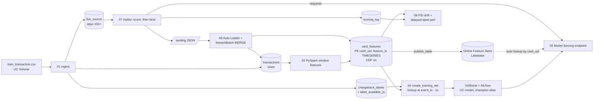

# Chargeback-risk model on Databricks

Predicts whether a card payment will later receive a chargeback (dispute), using the public
[IEEE-CIS Fraud Detection](https://www.kaggle.com/c/ieee-fraud-detection) data, on Databricks:

- **PySpark batch features** and **Structured Streaming** updates of per-card rolling features
- **Unity Catalog feature table** (offline, point-in-time) published to a **Databricks Online Feature Store** (online)
- **XGBoost** trained on a point-in-time training set, tracked and registered with **MLflow**
- **Model Serving** endpoint with automatic online feature lookup
- **Drift monitoring** (PSI per feature per day) and delayed-label performance tracking

> **What the label is.** In IEEE-CIS, `isFraud = 1` means the transaction later received a
> chargeback. So this is a *chargeback-risk* model (will this payment be disputed?). It is
> not a *dispute-outcome* model (will the merchant win the dispute?): no public dataset has
> representment outcomes.

## Architecture



## Design decisions

| Decision | Why |
|---|---|
| Card key = `card1 + addr1 + (day - D1)` | IEEE-CIS has no card ID; this is the usual reconstruction. |
| Feature row = card state **after** all transactions at `feature_ts`, window `(t-W, t]` | The online store keeps the latest row per card, which is exactly the state the next transaction should see. |
| Training lookup at `event_ts - 1s` | The point-in-time join never lets a transaction see its own update, so there is no target leakage. |
| `secs_since_last_txn`, `amt_vs_mean_7d`, `amt_cents` computed **inside the model** | Request-time features use the same code offline and online, so there is no training-serving skew. |
| Stream recomputes affected cards from the batch's **earliest** event, with 7 days of lookback, then MERGEs | Late and out-of-order events stay correct; MERGE on `TransactionID` makes replayed batches idempotent. Tested to equal a full recompute. |
| Out-of-time split: train [0,120), valid [120,150), live 150+ | A random split would leak future card behaviour. |
| Threshold set from **analyst capacity** (alerts/day) on validation | The operational constraint is review capacity, not a 0.5 cut-off. |
| Labels carry `label_available_ts` (`label_maturity_days`, default 60) | Chargebacks arrive weeks later. Performance monitoring only uses labels that have matured. The data gives no chargeback date, so the maturity window is an assumption. |
| PSI with a separate **missing** bin; request fields + score from `scoring_log`, card features from feature-table rows | A broken upstream join shows up as drift before labels arrive. |
| Promotion gate: `champion` alias only if validation PR-AUC is not worse | Every retrain doesn't automatically go live. |

## What has been verified, and where

| Part | Verified by |
|---|---|
| Feature definitions, point-in-time lookup, incremental-stream algorithm (incl. out-of-order) | `tests/` (pandas reference, 16 tests) |
| Scorer preprocessing, capacity threshold, PSI incl. missing-value spike | `tests/` |
| Whole pipeline logic on synthetic data | `scripts/local_demo.py` |
| **PySpark features, foreachBatch MERGE, Spark drift bins == the tested reference** | `notebooks/03_parity_check.py`, which must pass on Databricks before anything downstream is trusted |
| Feature store / online store / serving / bundle APIs | Only on a workspace (they are written against the current Databricks docs) |

The local demo runs on synthetic data with a planted fraud pattern and planted drift.
Its numbers are not results. Real metrics come from running `04` on IEEE-CIS.

## Run it

**Workspace.** The online store and automatic feature lookup need Lakebase / Online Feature
Store, which Databricks Free Edition does not offer (it is serverless-only and has no online
tables). Options:

- **Full path:** a Databricks free trial workspace, `use_online_store=true`.
- **Free Edition:** `use_online_store=false`. Everything else runs; the replay sends card
  features in the request instead of the endpoint looking them up, and streaming runs as
  scheduled `availableNow` micro-batches.

**Steps**

1. Kaggle → `ieee-fraud-detection` → accept rules → download `train_transaction.csv`.
2. `databricks bundle deploy -t dev` (or import the repo as a Git folder).
3. Upload the CSV to `/Volumes/main/disputes_ml/raw/ieee-cis/` (run notebook 01 once first to create the volume, or create it in Catalog Explorer).
4. Run job `chargeback-risk-build` (ingest → features → **parity** → train → deploy).
5. Run `chargeback-risk-replay` (scores days 150+ and streams them into the feature table).
6. Run `chargeback-risk-monitor` (drift + delayed-label performance).

Smoke test without Kaggle: run notebook 01 with `source=synthetic`.

```bash
# local checks
python -m pytest -q
python scripts/local_demo.py
```

## Known limitations

- The replay advances card state once per day, so same-day transactions on one card don't see
  each other in the replay. Production would stream continuously.
- Windowed counts online mean "within W before the card's last transaction", not "before now".
  Training uses the same as-of semantics, so there is no skew, and `secs_since_last_txn`
  carries recency.
- `D*` columns are time deltas that grow with calendar time, so they drift by construction.
  Normalising them (e.g. `day - D`) is the next feature iteration.
- Only `train_transaction.csv` is used; the identity table (device, browser) is a natural next join.
- Card-level prior-chargeback features need label maturity in the point-in-time logic; left out of v1 on purpose.

## Layout

```
src/disputes_ml/
  config.py schema.py          names, windows, splits, column contracts
  prep.py features.py          PySpark: typing + card_uid, window features
  streaming.py                 Auto Loader + foreachBatch MERGE
  feature_store.py             UC feature table DDL, online store publish
  scorer.py model_wrapper.py   preprocessing + XGBoost, MLflow pyfunc
  train.py                     training set, XGBoost, MLflow, UC registry, promotion gate
  serving.py                   endpoint deploy + client
  monitoring.py drift.py       replay, PSI drift, delayed-label performance
  metrics.py                   PR-AUC, capacity threshold
  features_ref.py synthetic.py pandas reference spec, synthetic data
notebooks/01-08                Databricks notebooks (source format)
databricks.yml                 Asset Bundle: build, stream, replay, monitor jobs
```
